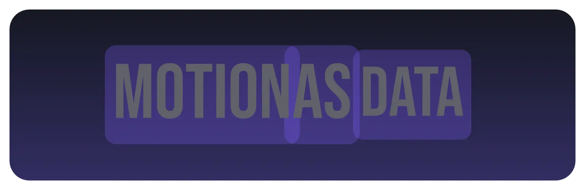
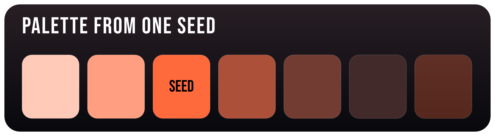
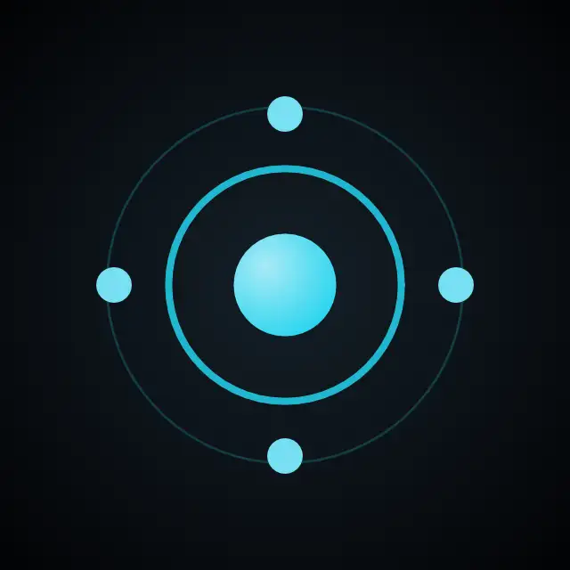
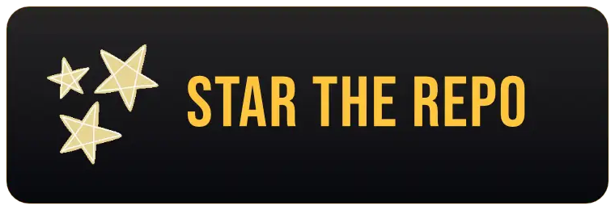
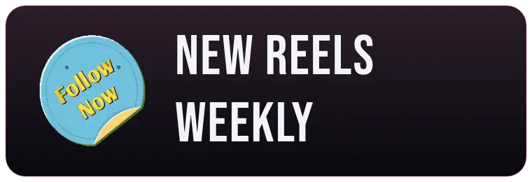

# Kine

[](https://github.com/lockvoid/ferment-kine/actions/workflows/ci.yml)
[](#license)

Kine renders motion graphics from JSON documents. You provide a document, a
time, and optional input values; the engine returns a frame. Documents describe
text, shapes, images, colors, and animation without embedding scripts or managing
a playback clock.

A shared Rust core provides CPU rendering, optional GPU rendering, a C ABI, and
Ruby, Swift, and Kotlin bindings. Use it for title cards, animated text, stickers,
and other graphics that need the same document format across platforms.



## Render your first frame

Install Rust with rustup. The checkout selects the pinned toolchain from
[crate/rust-toolchain.toml](crate/rust-toolchain.toml).

From the repository root:

```sh
cd crate
cargo run --locked -- ../docs/hero.json \
  --font testdata/font.ttf \
  -t 0.5 --signals '{"progress":0.5}' \
  --size 800x260 -o /tmp/kine-card.png
```

This registers the bundled demo font and writes a PNG. The
[complete example document](docs/hero.json) produces the animation above. Change
`progress` to move the text animation or `-t` to sample a different time.

Font registration is explicit: documents reference font families, and the host
registers the corresponding TTF or OTF bytes. The engine does not search system
fonts. Missing families are errors unless the host selects a fallback family.

## What a document contains

| Part | Purpose |
| --- | --- |
| `inputs` | Typed values such as text, time, progress, and accent color. Defaults make a document render without supplied signals. |
| `colors` | Named colors derived from inputs using `mix`, `alpha`, and `contrast`. |
| `assets` | Embedded PNG, JPEG, WebP, GIF, or APNG image data. |
| `root` | A tree of groups, shapes, text, and image nodes. |
| `animators` | Curves that map inputs to node or text-unit properties. |

The [schema reference](crate/docs/SCHEMA.md) defines the accepted JSON, defaults,
validation rules, and resource limits. Unknown fields and invalid references
are rejected at load. `probe` reports the document's interface; `admit` repairs
only the explicitly defined authoring cases before validating the result.

Time is an input rather than hidden engine state. Text can animate by glyph,
word, or line, including karaoke activation arrays. Springs are baked into
curves at load, so rendering a frame does not run a physics simulation.

## Choose a binding

| Binding | Build and usage guide |
| --- | --- |
| Rust / C | [crate/include/kine.h](crate/include/kine.h) defines the native ABI. Rust tools can also use `kine::oneshot` for PNG rendering. |
| Ruby | [ruby/README.md](ruby/README.md) covers the git-sourced gem and native extension. |
| Swift | [swift/README.md](swift/README.md) covers building the XCFramework and adding the package. |
| Kotlin / Android | [kotlin/README.md](kotlin/README.md) covers JNA, the native library, and Android packaging. |

For repeated renders, create a document handle once and reuse it. The handle
keeps parsed data, shaped resources, and decoded images. The bindings expose
PNG or premultiplied RGBA output as appropriate for their host.

For example, after building the Ruby extension, render from the repository root:

```ruby
require_relative "ruby/lib/kine"

Kine.register_font(File.binread("crate/testdata/font.ttf"))
document = File.read("docs/hero.json")
png = Kine.render_document(document, t: 0.5, signals: { progress: 0.5 },
                           width: 800, height: 260)
File.binwrite("/tmp/kine-card.png", png)
```

## More examples

[docs/palette.json](docs/palette.json) derives a palette from one accent input.
Changing the seed updates light and dark chips, translucent fills, and contrasting
ink inside the document.



[docs/pulse.json](docs/pulse.json) combines vector shapes, gradients, and looping
transforms driven by the same time input.



Animated image assets can share a clock with text and shape animation:




These sticker demo files come from [KLIPY](https://klipy.com); the provider's
terms apply separately from the source-code license. The
[fetch script](scripts/fetch-stickers.sh) documents their source and requires
an API key supplied through the environment.

[The demo renderer](scripts/render-readme-assets.rb) builds the README images.
Its still images are checked in CI; animated WebP generation also needs ffmpeg.

## Rendering and reproducibility

The CPU renderer is the default. Feature `gpu` enables Metal rendering for
Apple hosts; `gpu-gles` enables rendering on a host-provided EGL context for
Android. The native build scripts select the appropriate feature.

Document evaluation uses no hidden clock, unseeded randomness, or environment
reads. Pixel comparisons also depend on renderer versions, backend, and
architecture. Tests compare committed goldens byte for byte on the reference
architecture. CI reports cross-architecture differences separately, and GPU
parity tests use their declared tolerance. Byte-identical output across every
backend and architecture is not a compatibility promise.

## Develop and test

From `crate/`:

```sh
cargo fmt --check
cargo clippy --locked --all-targets -- -D warnings
cargo test --locked
```

Binding tests and native build requirements are in their guides. See
[CONTRIBUTING.md](CONTRIBUTING.md) before changing the schema or golden images,
and [SECURITY.md](SECURITY.md) for private vulnerability reports.

The library is pre-1.0 and uses schema version 1. Breaking changes are recorded
in [CHANGELOG.md](CHANGELOG.md). Crate and schema versions are separate;
`kine_version()` and `probe` expose them. The pinned Rust toolchain is the
supported development toolchain; there is no separate pre-1.0 MSRV promise.

## License

Copyright 2026 LockVoid Labs. The source is available under
[Apache-2.0](LICENSE-APACHE) or [MIT](LICENSE-MIT), at your option.

The bundled test font, Bebas Neue by Dharma Type, uses the
[SIL Open Font License 1.1](LICENSE-OFL.txt). The bundled Inter font has its
[own OFL notice](crate/assets/Inter-OFL.txt).
